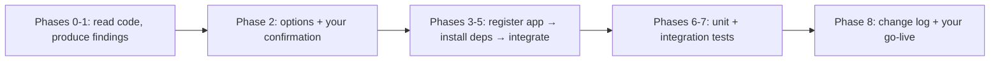
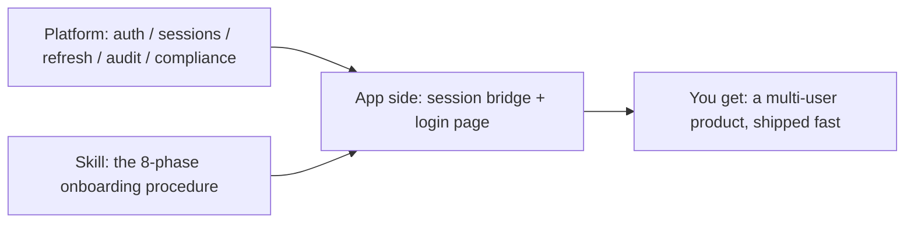

"Can AI refactor an open-source app into a multi-user product?" Yes — and getting started is simpler than you might expect: **one copyable prompt + one GitHub URL**, handed to your AI coding assistant, and it takes it from there. On 2026-10-13, we ran the full exercise with the open-source note-taking app [Novel](https://github.com/steven-tey/novel): from a single-player app with no accounts and shared documents, into a production app with SSO login, per-user document isolation, and AI capabilities — the main refactor finished in one AI collaboration session and shipped the same day.

We started from those same two things. The only difference: **we went first.** Every friction point that a first run hits is now off the path — folded back into the official skill, SDK, and scaffold. What you get is the version with the pits already filled.

## How to Start: Two Things

To refactor an app (use Novel for practice, or your own project), all you need are:

1. **A GitHub URL** — e.g. [github.com/steven-tey/novel](https://github.com/steven-tey/novel), or your own repository.
2. **One copyable prompt** — plug the repo URL into the sentence and hand it to the AI ([www.autional.com/ai](https://www.autional.com/ai) has this same prompt; for Chinese projects, [www.autional.cn/ai](https://www.autional.cn/ai) carries the Chinese version):

```
Fetch https://www.autional.com/ai/skill.md and follow it to add Autional login to https://github.com/steven-tey/novel, turning it into a multi-user product (per-user data isolated and persisted in platform storage); once that's done, deploy it live on Vercel.
If unreachable, use: https://cdn.autional.com/ai/latest/SKILL.md
```

Swap the repo URL for your own project and that sentence is your prompt; to practice on Novel first, copy it verbatim. Hand it to your AI coding assistant (Claude Code, Cursor, and others) — it takes you from integration to a live deployment in the same session.

## We Started the Same Way

This is not a methodology written after the fact. When we kicked off this exercise on 2026-10-13, our starting point was exactly the same: a task prompt handed to an AI + a GitHub URL. The AI surveyed candidate projects, selected Novel at a confirmation gate, then completed the integration following the skill and shipped the same day.

There is only one difference between us and you: **we went first.** The friction of a first run — choosing regions and endpoints, registering callback URLs, wiring the same-origin proxy, handling sessions and logout to the standard — was later folded back into the skill, SDK, and scaffold. Today, those steps either ship with sensible defaults, or the AI handles them as part of the procedure. The only point of our first run was to make sure you never have to repeat it.

In one line: **we handle the tedious parts; you enjoy the result.**

## Before and After

| Dimension | Before (stock Novel) | After |
|-----------|----------------------|-------|
| Accounts | None — open and go | Email + password, or one-click "Continue with Autional" SSO (OAuth 2.0 + PKCE) |
| Data | Everyone shares one pool of documents | Multi-user isolation — documents are private per user |
| Sessions | No session concept | Automatic token refresh, cross-tab sync, viewable and revocable device sessions |
| Sign-out | — | Standard OIDC logout: the session really ends, and switching accounts works |
| AI features | Bring your own model key, uncontrolled cost | Platform AI relay with unified metering |
| Deployment | Local only | Production (Vercel + platform storage) |
| Operations | No account system to operate | Users, audit, and security policy managed in platform portals — no admin backend to build |

This is not a mockup — **the demo environment stays open, and you can verify it yourself**: [novel-demo-nine.vercel.app](https://novel-demo-nine.vercel.app) (login, data isolation, and account switching are all testable). The refactored code is available for reference too: [github.com/autional-demo/novel](https://github.com/autional-demo/novel).

## What Happens After You Hand It Over: Eight Phases

The process is not a black box. It is a written procedure. The skill splits "refactor an app" into 8 phases, which the AI executes in order:



*Figure 1: the eight phases of the onboarding skill — executed in order, pausing for your confirmation at every phase boundary.*

Four ground rules make this method trustworthy:

| Rule | Meaning |
|------|---------|
| Findings first | Phase 1 is read-only: the AI analyzes your codebase and presents integration points and options before touching anything |
| Confirmation gates | Every phase ends by showing results and waiting for your go-ahead — no black-box changes |
| Branch isolation | All changes land on an isolated branch, `feature/autional`, with a checkpoint commit per phase — the main branch stays untouched |
| Closing the loop | The build must pass, unit and integration tests run, and an `AUTIONAL_CHANGES.md` file records every change |

## What the Process Looks Like: Three Stages

### Stage 1 · Register the app (minutes)

Create an OAuth client in the developer portal (`developer.autional.com` / `.cn`) with two values: the callback URL (`redirect_uris`) and the cross-origin source (`cors_origins`). That returns a client ID — for local development, `http://localhost:3000/oauth/callback` is enough to get started.

### Stage 2 · Hand the prompt to the AI (one session)

Hand the prompt from above to your AI coding assistant (the repo URL is already inside it). The AI then walks the eight phases from Figure 1: environment check → code analysis → strategy confirmation → app registration → dependency install → code integration → tests → wrap-up. You do exactly two things: **call the shots at each confirmation gate, and give the go-ahead at the end**.

For brand-new projects, the faster path is a one-command scaffold:

```bash
npx @autional/onboard
```

Pick a framework (React / Vue / Next.js) and a region (`.com` / `.cn`); the generated project ships with SSO login, the OAuth callback, and region defaults wired in. Existing apps use the skill, new projects use the scaffold — both share the same `@autional/core` SDK.

### Stage 3 · Ship it (minutes)

Deploy to your hosting platform (Vercel, in our case) and register the production callback URL back on the client. Before shipping, integration tests already covered the critical paths: login, data isolation, and account switching.

## The Causal Chain: Why the App-Side Change Is So Small



*Figure 2: complexity settles in the platform, determinism comes from the skill, and the app side only builds a thin bridge.*

Three causal lines explain it:

1. **The hard parts of auth live in the platform, not in your code.** Password policy and transmission, token refresh and rotation, cross-tab session sync, device management, audit logging, CAPTCHA, and compliance checks — all implemented and operated on the platform side. What the app integrates is a thin "session bridge": login redirect, callback handling, automatic token injection.
2. **Determinism comes from the skill, not from the AI improvising.** Integration is not the AI free-styling; it is the AI executing a fixed, gated, phase-by-phase procedure. That is why the same method produces consistent results across Next.js / React / Vue / Node projects.
3. **Every real exercise raises the starting point of the next project.** Each friction point surfaced by a real refactor is folded back into the platform's skill, scaffold, and SDK — so the next project starts further ahead. That is the mechanism behind "we went first, so you don't have to."

## What Your App Has After the Refactor

- Users sign in with email + password, or one-click "Continue with Autional" (OAuth 2.0 + PKCE)
- Data is isolated per user — in this exercise, Novel documents became private to each user
- Session tokens refresh automatically and sync across tabs; users can view and revoke their device sessions in the platform portal
- Signing out properly ends the SSO session — switching accounts actually switches users
- If your app has AI features, traffic can route through the platform AI relay with unified metering
- User management, audit, and security policy live in platform portals — no admin backend to build

## Start Your Refactor

1. Register your app in the developer portal and get a client ID
2. Copy the prompt above (with your repo URL in place of Novel's) and hand it to your AI coding assistant; for new projects run `npx @autional/onboard`
3. Deploy

The prompt and skill document contain zero secrets and every endpoint in them is a public URL — safe to hand to your AI assistant. For onboarding guidance, see [www.autional.com/ai](https://www.autional.com/ai). And you can verify Novel's result yourself in the demo environment: https://novel-demo-nine.vercel.app
