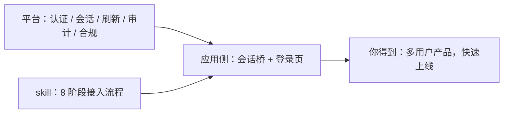

「能不能用 AI 把一个开源应用改造成多用户产品？」可以，而且起步比你想的简单：**一段可复制的 prompt + 一个 GitHub 地址**，交给你的 AI 编码助手，剩下的它来。2026-10-13，我们以开源笔记应用 [Novel](https://github.com/steven-tey/novel) 为对象走完了全程：从「无账号、文档所有人共享」的单机应用，改造成带 SSO 登录、多用户私有隔离、AI 能力的生产应用——主体改造在一个 AI 协作会话内完成，当天部署上线。

我们当初也正是从这两样东西开始的。唯一的不同是：**我们是第一遍**。第一遍会撞上的摩擦点，现在都不在路径上了——它们被逐一填平，写进了官方的 skill、SDK 与脚手架。你拿到的，是「已填坑」的版本。

## 怎么开始：两样东西

改造一个应用（用 Novel 练手，或换成你自己的项目），需要准备的只有两样：

1. **一个 GitHub 地址**——比如 [github.com/steven-tey/novel](https://github.com/steven-tey/novel)，或你自己的项目仓库。
2. **一句可以直接复制的 prompt**——把仓库地址写进句子交给 AI 即可（[www.autional.cn/ai](https://www.autional.cn/ai) 有同款；英文项目走 [www.autional.com/ai](https://www.autional.com/ai)，页面附英文版）：

```
请读取 https://www.autional.cn/ai/skill.md，并据此为 https://github.com/steven-tey/novel 完成改造：接入 Autional 登录，把它从单用户应用改造成多用户产品（用户数据隔离并持久化到平台存储）；改造完成后部署上线到 Vercel。
若打不开，改用国内镜像：https://cdn.autional.cn/ai/latest/SKILL.md
```

把仓库地址换成你自己的项目，这句话就是你的 prompt；想先用 Novel 练手，直接照抄。交给 AI 编码助手（Claude Code、Cursor 等）即可——从接入到部署上线，在同一个会话里完成。

## 我们当初也是这么开始的

这不是一套事后总结的方法论。2026-10-13 发起这项改造时，我们的起点同样是：一份交给 AI 的任务 prompt + 一个 GitHub 地址。AI 先调研候选项目，经确认门选定 Novel，然后按 skill 完成集成、当天部署上线。

我们和你之间只有一条区别：**我们是第一遍**。第一遍会遇到的摩擦——区域与端点的选择、回调地址的登记、跨域代理的接线、会话与登出的标准处理——后来都被收敛进了 skill、SDK 与脚手架：现在这些步骤要么已内置默认值，要么由 AI 按流程自动处理。我们走过的那一遍，唯一的意义就是让你不必再踩一遍我们踩过的坑。

一句话：**麻烦的事情我们处理，你享受成果。**

## 改造前与改造后

| 维度 | 改造前（原生 Novel） | 改造后 |
|------|---------------------|--------|
| 账号 | 无登录，打开即用 | 邮箱密码登录，或「Continue with Autional」一键 SSO（OAuth 2.0 + PKCE） |
| 数据 | 所有人共享同一份文档 | 多用户隔离，文档各自私有 |
| 会话 | 无会话概念 | 令牌自动续期、跨标签页同步，可查看与撤销设备会话 |
| 登出 | —— | 标准 OIDC 登出：正确终结会话，换号即换人 |
| AI 能力 | 需自配模型 Key，费用不可控 | 平台 AI 中继，用量统一计量 |
| 部署 | 本地运行 | 云端生产上线（Vercel + 平台存储） |
| 运维 | 无账号体系可运维 | 用户、审计与安全策略在平台门户管理，应用不自建后台 |

以上不是效果图——**演示环境长期开放，可以亲手验证**：[novel-demo-nine.vercel.app](https://novel-demo-nine.vercel.app)（登录、数据隔离、账号切换都可实测）；改造后的代码也可以对照：[github.com/autional-demo/novel](https://github.com/autional-demo/novel)。

## 交给 AI 之后：八个阶段

这里的执行过程不是黑盒推理，而是一份写死的流程约束。skill 把「改造一个应用」拆成 8 个阶段，AI 照单执行：


*图 1：接入技能的八个阶段，按顺序执行，每个阶段结束都会停下等你确认。*

四条关键规则，也是这套方法可信的原因：

| 规则 | 含义 |
|------|------|
| 判据先行 | 阶段 1 只读不改：AI 先分析你的代码库，给出接入点与方案选项，再动手 |
| 确认门 | 每个阶段结束展示结果、等你拍板才继续——没有黑箱操作 |
| 分支隔离 | 全部改动在独立分支 `feature/autional` 上进行，每阶段留检查点提交，主干零风险 |
| 验收闭环 | 构建必须通过，单测与集成测试跑完，最后留下一份 `AUTIONAL_CHANGES.md` 完整改动清单 |

## 过程是怎样的：三个阶段

### 第一步 · 注册应用（几分钟）

在开发者门户（`developer.autional.com` / `.cn`）创建一个 OAuth 客户端，填两个地址：回调地址（`redirect_uris`）与跨域来源（`cors_origins`）。拿到 client ID 即完成——本地开发用 `http://localhost:3000/oauth/callback` 就能跑起来。

### 第二步 · 把 prompt 交给 AI（一个协作会话）

把上面那句 prompt 交给你的 AI 编码助手（仓库地址已写在里面）。AI 随后按图 1 的八个阶段推进：环境检查 → 代码分析 → 方案确认 → 应用注册 → 依赖安装 → 代码集成 → 测试 → 收尾。你只需要做两件事：**在确认门处拍板，在最后放行上线**。

如果是全新项目，更快的路径是脚手架一条命令起盘：

```bash
npx @autional/onboard
```

选择框架（React / Vue / Next.js）与区域（`.com` / `.cn`），生成的项目已内置 SSO 登录、OAuth 回调与区域配置。已有应用走 skill，新项目走脚手架——两条路共用同一套 `@autional/core` SDK。

### 第三步 · 上线（分钟级）

部署到你的托管平台（本次是 Vercel），把生产回调地址登记回客户端即可。上线前，集成测试已经覆盖登录、数据隔离、账号切换等关键路径。

## 因果链：为什么应用侧这么简单



*图 2：复杂性沉淀在平台，流程确定性来自 skill，应用侧只做一层薄桥接。*

展开即三条因果线：

1. **认证的麻烦事在平台，不在你的代码里。** 密码策略与哈希传输、令牌刷新与轮转、多标签页会话同步、设备管理、审计日志、验证码与合规检查——这些实现和运维都发生在平台侧。应用侧接入的是一层「会话桥」：登录跳转、回调处理、令牌自动注入。
2. **流程的确定性来自 skill，而不是 AI 的临场发挥。** 接入不是让 AI 自由发挥，而是让它执行一份有确认门的分阶段流程。这就是为什么同样的方法在 Next.js / React / Vue / Node 项目上结果一致。
3. **每一轮实战都在抬高下一个项目的起点。** 真实改造中暴露的每一个摩擦点，都会被平台收敛进 skill、脚手架与 SDK——下一个项目直接免疫。这也是「我们走过一遍，你就不用再走」的机制。

## 上线后，你的应用里有什么

- 用户用邮箱密码登录，或一键「Continue with Autional」（OAuth 2.0 + PKCE）
- 每位用户的数据互相隔离——本次改造中，Novel 的文档按用户私有
- 会话令牌自动续期、跨标签页同步；用户可在平台门户查看并撤销自己的设备会话
- 退出登录正确终结 SSO 会话，换号即换人
- 应用若带 AI 功能，可经平台 AI 中继统一计量
- 用户管理、审计与安全策略在平台门户完成，无需应用自建后台

## 开始你的改造

1. 在开发者门户注册应用，拿到 client ID
2. 复制上面那句 prompt（把仓库地址换成你的），交给 AI 编码助手；新项目用 `npx @autional/onboard`
3. 部署上线

Prompt 与 skill 文档零密钥、全部端点为公开地址——放心交给 AI 助手。想了解接入指引，访问 [www.autional.cn/ai](https://www.autional.cn/ai)；Novel 的改造结果在演示环境里可以亲手验证：https://novel-demo-nine.vercel.app
